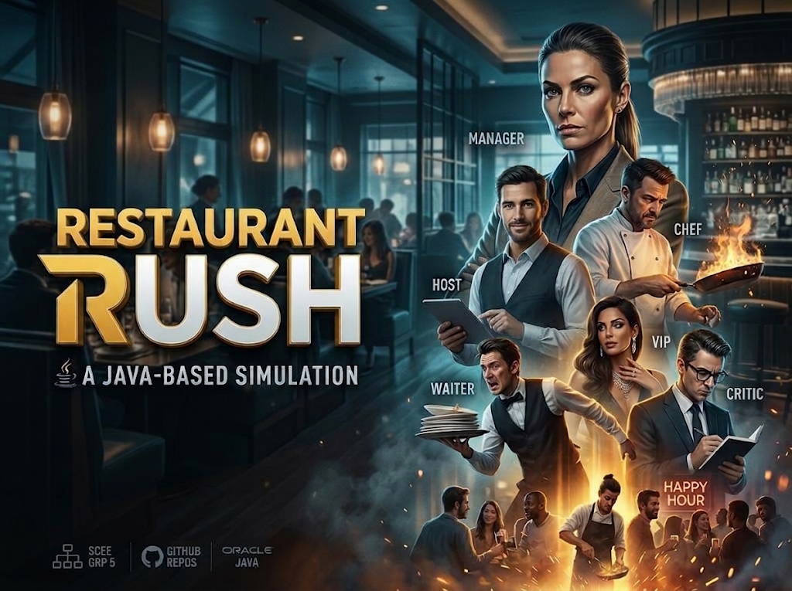

# Restaurant Rush

SC2002 group assignment (SCEE GRP 5): a turn-based restaurant management game in Java, played in the console.
You are the manager. Staff time is limited, so you decide which customers and orders come first. The game was built in three tagged, independently runnable stages.

**Repository:** https://github.com/RobinTeoh/restaurant-rush-sc2002

## Contents
[Quick start](#quick-start) · [Submission index](#submission-index) · [Base setting and reproducible runs](#base-setting-and-reproducible-runs) · [Stages and tags](#stages-and-tags) · [Diagrams](#diagrams) · [Video](#video) · [AI history](#ai-history) · [Team](#team) · [Documentation map](#documentation-map)

## Quick start
- JDK 17 or newer (compiled with `--release 17`)
- No network access needed; JUnit is bundled in `lib/`

| | Windows (cmd) | macOS / Linux / Git Bash |
|---|---|---|
| Build | `build.bat` | `sh build.sh` |
| Run | `run.bat` | `sh run.sh` |
| Test | `test.bat` | `sh test.sh` |
| Replay a run | `run.bat stage1 < runs\stage1-victory.txt` | `sh run.sh stage1 < runs/stage1-victory.txt` |

Build before running (`run` uses the last build). Type a number and press Enter to answer each prompt.
Tests: 74 at `stage-1`, 102 at `stage-2`, 151 at `stage-3`; all pass at each tag, and CI replays every run file on each push.

## Submission index
Where to find each item the brief asks for.

| Item | Where |
|---|---|
| Source code, build and run instructions | [`src/`](src/), [`test/`](test/), [Quick start](#quick-start) |
| README (repository URL, stage links, video timestamps) | this file: [Stages and tags](#stages-and-tags), [Video](#video) |
| PDF report | submitted in the archive: diagrams, design discussion, functional evidence, reflections |
| Recorded video | [Video](#video) |
| Declarations (Original Work, use of GAI) | signed forms, submitted in the archive |
| Class diagrams (one per stage) | [Diagrams](#diagrams) |
| Sequence diagram (one scenario: VIP, Happy Hour, Combo at turn 4) | [Diagrams](#diagrams) |
| Design discussion (decisions, principles, alternatives) | [`docs/design/`](docs/design/) |
| Stage tags and comparisons | [Stages and tags](#stages-and-tags) |
| Tests and reproducible runs | [`test/`](test/), [`runs/`](runs/), [`docs/testing/test-notes.md`](docs/testing/test-notes.md) |
| Process evidence (CI, PR template, design log, roles) | [`.github/`](.github/), [`docs/design/design-log.md`](docs/design/design-log.md), [`docs/process/team-roles.md`](docs/process/team-roles.md), the pull requests on GitHub |
| AI history | each member's own branch: [AI history](#ai-history) (also the report, Appendix F) |

## Base setting and reproducible runs
18 turns, 2 tables, one Waiter, Chef and Cashier, customers arriving on turns 1, 4, 7, 10, 13 and 16.
Victory needs at least 4 paid customers, at least $45.00 revenue and an average satisfaction of at least 60.

**Customers (Stage 2):** Regular, **VIP**, Regular, **Critic**, Regular, Regular, in arrival order.
VIP loses 5 satisfaction per waiting turn and gets 10% off; Critic loses 12 and always orders the most expensive dish; Regular loses 8.

**How customers choose food:** customer *n* (1 to 6, in arrival order) picks a dish with `new Random(32 + n)`, so every run is the same.
The customers order Salad, Burger, Pasta, Pasta (the Critic), Pasta, Salad. Details: [DECISIONS.md](docs/design/DECISIONS.md) D5, D6, D6b and D7.

| Run file (replay at tag) | Result |
|---|---|
| `runs/stage3-victory.txt` (`stage-3`) | VICTORY: 4 paid, $87.57, average 80.0 (Happy Hour switched on in turn 7) |
| `runs/stage3-victory-happyhour-t4.txt` (`main`) | VICTORY: 4 paid, $86.80, average 75.5 (the report's Section 3 scenario: Happy Hour started at turn 4) |
| `runs/stage3-victory-continue-t4.txt` (`main`) | VICTORY: 4 paid, $91.17, average 74.3 (the same scenario, continuing at turn 4 without Happy Hour) |
| `runs/stage3-defeat.txt` (`stage-3`) | DEFEAT: the Chef is never given an order, so nobody is served |
| `runs/stage2-victory.txt` (`stage-2`) | VICTORY: 4 paid, $58.50, average 75.5 |
| `runs/stage2-victory-5paid.txt` (`stage-2`) | VICTORY: 5 paid, $76.50, average 73.2 (the most that can pay) |
| `runs/stage2-defeat.txt` (`stage-2`) | DEFEAT: the Chef is never given an order, so nobody is served |
| `runs/stage1-victory.txt` (`stage-1`) | VICTORY: 4 paid, $57.00, average 80.0 |
| `runs/stage1-victory-5paid.txt` (`stage-1`) | VICTORY: 5 paid, $75.00, average 76.0 |
| `runs/stage1-defeat.txt` (`stage-1`) | DEFEAT |
| `runs/stage1-edge-invalid-input.txt` (`stage-1`) | Invalid inputs are explained and asked again, then the input ends and the game plays on |

A run file belongs to its stage, because later stages change the customers and the menu. To replay one: `git checkout stage-N`, build, then `sh run.sh stageN < runs/stageN-...txt` (`run.bat stageN < ...` on Windows). Without the `stageN` argument the game starts the latest stage (Stage 3 at the `stage-3` tag; each tag defaults to its own stage).

The two `-t4` run files were added after the `stage-3` tag (for the report's Section 3 diagram), so replay them on `main`. The Stage 3 code is identical at the tag and on `main`.

What each run does, the edge cases and the test evidence: [docs/testing/test-notes.md](docs/testing/test-notes.md).

## Stages and tags
| Stage | Tag | Commit | Adds | Compare |
|---|---|---|---|---|
| 1 | `stage-1` | `14f368c` | Regular customers, menu, Waiter, Chef, Cashier, full turn sequence, both endings | first stage |
| 2 | `stage-2` | `68d2336` | VIP and Critic customers | [stage-1...stage-2](https://github.com/RobinTeoh/restaurant-rush-sc2002/compare/stage-1...stage-2) |
| 3 | `stage-3` | `e6ccf01` | Host, ComboMeal, Happy Hour | [stage-2...stage-3](https://github.com/RobinTeoh/restaurant-rush-sc2002/compare/stage-2...stage-3) |

Each tag builds and runs on its own: `git checkout stage-N`, build, then run.

What changed between stages, file by file and why: the report, Section 5 (Stage evolution), or the compare links above.

## Diagrams
All sources and images are in [`docs/uml/`](docs/uml/).

| Diagram | Files |
|---|---|
| Class diagram, Stage 1 | [`stage-1.png`](docs/uml/stage-1.png), [`stage-1-class-diagram.drawio`](docs/uml/stage-1-class-diagram.drawio) |
| Class diagram, Stage 2 | [`stage-2.png`](docs/uml/stage-2.png), [`stage-2-class-diagram.drawio`](docs/uml/stage-2-class-diagram.drawio) |
| Class diagram, Stage 3 (final) | [`stage-3.png`](docs/uml/stage-3.png), [`stage-3-class-diagram.drawio`](docs/uml/stage-3-class-diagram.drawio) |
| Sequence diagram (Figure 3-1, four parts) | [Part 1, messages 1-19](<docs/uml/Sequence Diagram-Part 1_ messages 1-19.png>), [Part 2, messages 20-51](<docs/uml/Sequence Diagram-Part 2_ messages 20-51.png>), [Part 3, messages 52-72](<docs/uml/Sequence Diagram-Part 3_ messages 52-72.png>), [Part 4, messages 73-89](<docs/uml/Sequence Diagram-Part 4_ messages 73-89.png>) |

The sequence diagram replays the scenario in [`runs/stage3-victory-happyhour-t4.txt`](runs/stage3-victory-happyhour-t4.txt); its alternative branch is [`runs/stage3-victory-continue-t4.txt`](runs/stage3-victory-continue-t4.txt).

## Video
Video link: TBD (fill in before submission)

| # | Segment | Speaker | Start |
|---|---|---|---|
| 1 | Game launch from the submitted project, and an overview of the three stages | Caleb | TBD |
| 2 | Meaningful manager choices, including a decision where staff are constrained | Caleb | TBD |
| 3 | A dish going READY, then SERVED, then paid | Robin | TBD |
| 4 | A VIP or Critic behaviour | Robin | TBD |
| 5 | A Stage 3 feature | Ian | TBD |
| 6 | One victory and one defeat (separate reproducible runs) | Ian | TBD |
| 7 | Stage tag comparisons and the class diagrams | Takshak | TBD |
| 8 | Use case and sequence diagram | Sibghat | TBD |
| 9 | Individual contributions and key learning | each member | TBD |

## AI history
Each member keeps their full AI conversation, in order and not summarised, on their own branch.

| Member | Branch |
|---|---|
| Ian Tan | [IanTan]( https://github.com/RobinTeoh/restaurant-rush-sc2002/tree/IanTan)|
| Robin Teoh | [`robin/ai-history`](https://github.com/RobinTeoh/restaurant-rush-sc2002/tree/robin/ai-history/ai-history) |
| Caleb Soon | TBD (branch to be added) |
| Takshak | [`Takshak`](https://github.com/RobinTeoh/restaurant-rush-sc2002/tree/Takshak) |
| Sibghat Ullah | [`Sibghat-Ullah`](https://github.com/RobinTeoh/restaurant-rush-sc2002/tree/Sibghat-Ullah) |

## Team
| Member | Role |
|---|---|
| Robin Teoh | Customers (`customer/`); customer state diagram |
| Ian Tan | Kitchen, menu and pricing (`menu/`, `order/`, `pricing/`, Chef), including ComboMeal and Happy Hour |
| Caleb Soon | Game loop, staff and CLI (`app/`, `boundary/`, `control/`, `place/`, Waiter, Cashier, Host), CI and tags |
| Takshak | Class diagrams, one per stage |
| Sibghat Ullah | Sequence diagram |

Who owns which folder, diagram, report section and video segment: [`docs/process/team-roles.md`](docs/process/team-roles.md).

## Documentation map
| Folder / file | What it holds |
|---|---|
| [`docs/design/DECISIONS.md`](docs/design/DECISIONS.md) | Rules the brief leaves open, and what we chose (D1-D15) |
| [`docs/design/CONTRACT.md`](docs/design/CONTRACT.md) | Method signatures between roles, checked against the code |
| [`docs/design/design-log.md`](docs/design/design-log.md) | Design choices, alternatives rejected, and why |
| [`docs/design/design-principles.md`](docs/design/design-principles.md) | Where SOLID genuinely shows in the code, and where it does not |
| [`docs/design/decision-summary.md`](docs/design/decision-summary.md) | One-page summary of every decision by stage |
| [`docs/testing/test-notes.md`](docs/testing/test-notes.md) | Reproducible runs, edge cases and test evidence per stage |
| [`docs/uml/`](docs/uml/) | The submitted class diagrams (one per stage) and the sequence diagram |
| [`docs/design/customer-drafts/`](docs/design/customer-drafts/) | Early Customer class and state drafts, kept as design history |
| [`docs/process/`](docs/process/) | Team roles, the original development plan, and the team manual (PDF and HTML) |
| [`runs/`](runs/) | Recorded player inputs for every stage, replayed by the tests and CI |
