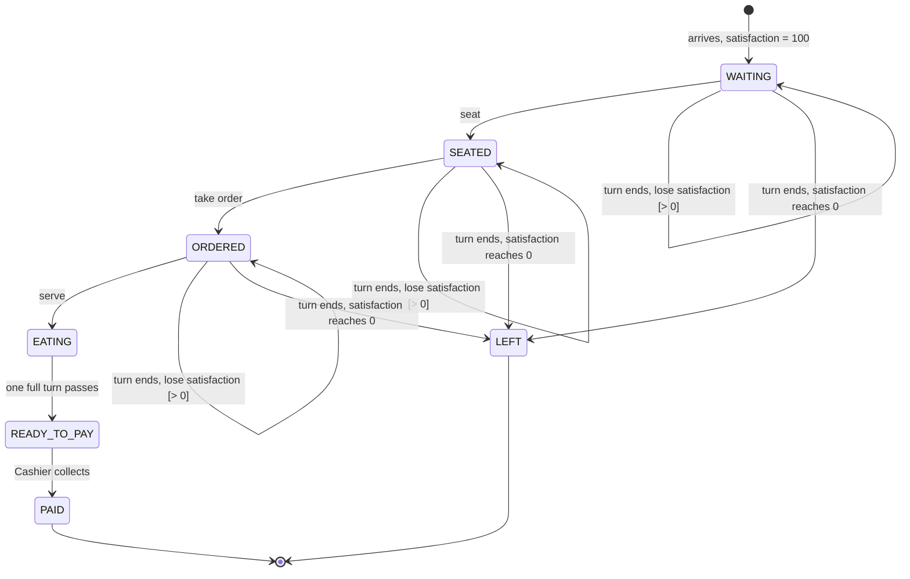

# Design log

One entry per design decision or change: what we chose, what we rejected, and why.
This feeds the report's trade-offs, alternative design and stage-evolution sections.

| Date | Decision | Alternatives considered | Why | Who |
|---|---|---|---|---|
| 2026-10-13 | The turn number is owned by `GameController` (private field, only the controller increments it). Customers never keep their own turn counter. | A `static` turn counter inside `Customer` | A static field is shared by every customer and every game (global mutable state), so tests could interfere with each other. A customer only needs to know that one turn passed (`loseSatisfaction()`), or be given the turn as a parameter. | Robin (A) |
| 2026-10-13 | Only WAITING, SEATED and ORDERED lose satisfaction at turn end. EATING and READY_TO_PAY do not (brief §3.2 step 5). | Stop the loss when the dish becomes READY | A READY dish that is not yet served still leaves the customer waiting. | Robin (A) |
| 2026-10-13 | A call made in the wrong state (e.g. `pay` while SEATED) throws `IllegalStateException`. Player mistakes never reach this: the Waiter/controller checks `getState()` first and shows a reason (brief §3.4). | Ignore the call, or return `false` | An exception exposes our own bugs immediately; invalid *player* choices are a separate, user-facing layer. | Robin (A) |
| 2026-10-13 | When satisfaction reaches 0 the customer only flags itself (`hasLeft()`). The controller cancels the order and frees the table. | Customer frees its own table and cancels its order | The customer should not reach into the Table or the kitchen (keeps dependencies pointing one way). | Robin (A) |
| 2026-10-14 | Customer state is a `CustomerState` enum (WAITING, SEATED, ORDERED, EATING, READY_TO_PAY, PAID, LEFT), and each `Customer` method checks the current state before changing it. | **State pattern**: one class per state (`WaitingState`, `SeatedState`, ...) that handles what a customer can do in that state; or storing the state as a `String` | 7 states with small behaviour differences: one class per state is a lot of extra classes for little gain. An enum is checked by the compiler (a typo fails to compile; a `String` typo would only fail at runtime). **Alternative design for the report.** | Robin (A) |
| 2026-10-14 | `Customer` has one named method per event (`seat()`, `takeOrder()`, `serve(turn)`, `finishEatingIfDue(turn)`, `pay()`, `loseSatisfaction()`), not a generic `setState(...)`. | A single `state(String)` setter | A setter lets any caller put the customer in any state, so the customer cannot enforce the state machine (encapsulation). | Robin (A) |
| 2026-10-14 | `Customer` does not store its table number. `Table` already knows its occupant. | `tableNo` field on `Customer` | Storing it twice can get out of sync, and no class needs to read it from the customer. | Robin (A) |
| 2026-10-14 | Turn memory: the controller passes the turn in (`serve(turn)`, `finishEatingIfDue(turn)`); the customer stores `servedTurn` and `readyToPayTurn`. | The controller keeps its own record of when each customer was served | All eating logic stays in one class and is easy to unit test; the Cashier reads `getReadyToPayTurn()` for "oldest first" (D2). | Robin (A) |
| 2026-10-14 | Food choice uses a `FoodPicker` (seeded `Random` + "max 2 Pasta" count, D5), created once per game and passed to each customer's constructor. `chooseFood(Menu)` keeps the contract signature. | Random inside each `Customer`; or pre-generating all choices in `ArrivalSchedule` | The seed and the Pasta count are game-level state, not per-customer state; a shared object keeps `Customer` free of global data and the contract unchanged. | Robin (A) |

## Customer state machine (draft v1, Stage 1)

Hand-drawn by Robin on 2026-10-13: [uml/customer-state-v1.png](uml/customer-state-v1.png). The first sketch wrongly had a PAID → LEFT arrow; it was removed (LEFT means "left unhappy without paying" and is counted as an unhappy departure in brief §3.5). The text version below is the same diagram.

Open points: who triggers EATING → READY_TO_PAY (the turn loop, step 4), and whether the customer counts the eating turn itself or is told the turn (see Step 3).
