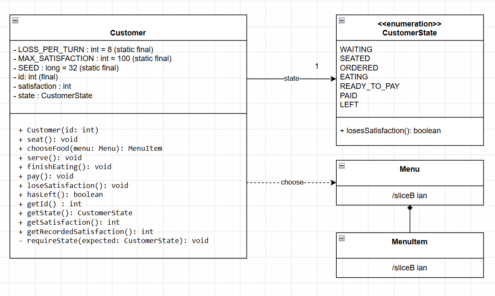
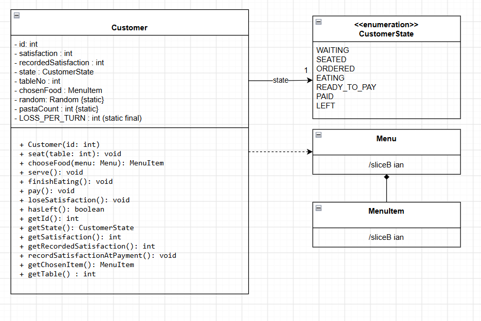
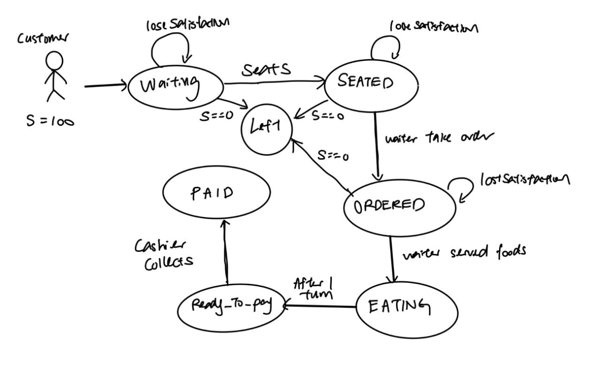
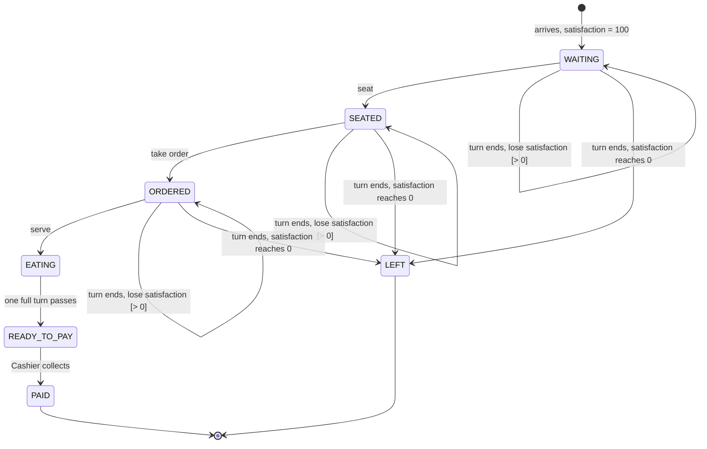

# Design log

One entry per design decision or change: what we chose, what we rejected, and why.
This feeds the report's trade-offs, alternative design and stage-evolution sections.

| Date | Decision | Alternatives considered | Why | Who |
|---|---|---|---|---|
| 2026-10-13 | The turn number is owned by `GameController` (private field, only the controller increments it). Customers never keep their own turn counter. | A `static` turn counter inside `Customer` | A static field is shared by every customer and every game (global mutable state), so tests could interfere with each other. A customer only needs to know that one turn passed (`loseSatisfaction()`), or be given the turn as a parameter. | Robin (A) |
| 2026-10-13 | Only WAITING, SEATED and ORDERED lose satisfaction at turn end. EATING and READY_TO_PAY do not (brief §3.2 step 5). | Stop the loss when the dish becomes READY | A READY dish that is not yet served still leaves the customer waiting. | Robin (A) |
| 2026-10-13 | A call made in the wrong state (e.g. `pay` while SEATED) throws `IllegalStateException`. Player mistakes never reach this: the Waiter/controller checks `getState()` first and shows a reason (brief §3.4). | Ignore the call, or return `false` | An exception exposes our own bugs immediately; invalid *player* choices are a separate, user-facing layer. | Robin (A) |
| 2026-10-13 | When satisfaction reaches 0 the customer only flags itself (`hasLeft()`). The controller cancels the order and frees the table. | Customer frees its own table and cancels its order | The customer should not reach into the Table or the kitchen (keeps dependencies pointing one way). | Robin (A) |
| 2026-10-14 | Customer state is a `CustomerState` enum (WAITING, SEATED, ORDERED, EATING, READY_TO_PAY, PAID, LEFT), and each `Customer` method checks the current state before changing it. | **State pattern**: one class per state (`WaitingState`, `SeatedState`, ...) that handles what a customer can do in that state; or storing the state as a `String` | 7 states with small behaviour differences: one class per state is a lot of extra classes for little gain. An enum is checked by the compiler (a typo fails to compile; a `String` typo would only fail at runtime). **Alternative design for the report.** | Robin (A) |
| 2026-10-14 | `Customer` does not store its table number. `Table` already knows its occupant. | `tableNo` field on `Customer` | Storing it twice can get out of sync, and no class needs to read it from the customer. | Robin (A) |
| 2026-10-15 | `Customer` follows the agreed CONTRACT.md methods: `loseSatisfaction()`, `hasLeft()`, `chooseFood(Menu)`, `getState()`, plus `getRecordedSatisfaction()`, which the contract itself lists as a gap. The one exception is payment (next rows: `pay()`). | Adding methods on our own | The contract is what keeps the three parts independent. | Robin (A) |
| 2026-10-16 | Food choice (D5): customer *n* picks its own dish with `new Random(SEED + n)` inside `chooseFood(menu)`. **No Pasta counter in code**: the fixed seed is chosen so the six customers give at most 2 Pasta, and a unit test checks it. Proposed seed **32** (Salad, Burger, Pasta, Burger, Pasta, Salad with menu order Salad, Burger, Pasta): any 4 of the first 5 customers ≥ $57. | `static` shared `Random` + `static` Pasta count in `Customer`; a separate `FoodChooser` class (injected, or replaying customers 1..n); a runtime check that re-rolls the seed until it is winnable | Static fields are hidden global state (tests leak into each other) and a game-wide count is not a customer's job (SRP). Each customer's choice now depends only on itself, so no shared state and no extra class are needed, and Caleb only does `new Customer(id)`. The seed is a constant, so a runtime check would give the same answer every run; checking once in a test is enough. **Trade-off for the report:** every game has the same orders; variety comes from the manager's choices. *Seed and "no counter" need team agreement (D5/D6); re-check once Ian's menu order is known.* | Robin (A) |
| 2026-10-15 | `loseSatisfaction()` does nothing outside WAITING, SEATED and ORDERED (as the contract note says), because it is called on every customer at turn end. Which states lose satisfaction is decided by `CustomerState.losesSatisfaction()`. | Throwing when called on an EATING customer; a private check inside `Customer` | Being called on everyone each turn is normal, not a bug. Which states wait for service is knowledge about the states, so it lives in the enum (cohesion). | Robin (A) |
| 2026-10-16 | **Payment uses `pay()`** (READY_TO_PAY → PAID). **Differs from CONTRACT.md**, which has `recordSatisfactionAtPayment()`. *To agree with Caleb:* either the contract changes to `pay()`, or `pay()` is renamed. | Keeping both `pay()` and `recordSatisfactionAtPayment()` public | Two public ways to do one thing: the Cashier could call the wrong one, or both, or record before paying. One method cannot be called out of order. | Robin (A) |
| 2026-10-16 | No separate recorded-satisfaction field. `getRecordedSatisfaction()` returns the satisfaction once the customer is PAID, and throws before that. | A `recordedSatisfaction` field with `-1` meaning "not paid yet" | Satisfaction cannot change after SERVED, so the value at payment is the current value. Two copies could drift, and `-1` is a magic value. | Robin (A) |
| 2026-10-16 | `Customer` no longer stores `tableNo` or `chosenFood`. | `tableNo`/`getTable()` and `chosenFood`/`getChosenItem()` | `Table` already knows its occupant and `Order` already holds the dish; a second copy can get out of sync. If Caleb needs `getTable()`, it is a small addition. | Robin (A) |
| 2026-10-15 | **Stage 1 `Customer` is one ordinary (not abstract) class**, with a constant `LOSS_PER_TURN = 8`. No subclasses in Stage 1. | Abstract `Customer` + `RegularCustomer`, with the loss as an overridable method or a constructor parameter (DECISIONS D13) | Stage 1 is designed from the Stage 1 requirements only (professor's guidance): there is one kind of customer and one loss value. When Stage 2 adds VIP and Critic, `Customer` becomes the parent class and the loss moves into the subclasses; that refactor is explained in the README's Stage 1 → 2 section. | Robin (A) |
| 2026-10-15 | **No discount method in Stage 1.** In Stage 1 the bill is the item price. The discount (and the B → A `getDiscountPercent()` call) is added in Stage 2 with `VIPCustomer`. | `getDiscountPercent()` returning 0 from Stage 1 (agreed plan, CONTRACT.md B → A) | Stage 1 is designed from the Stage 1 requirements only (professor's guidance), so a discount that is always 0 does not belong there. Adding it in Stage 2 is a documented Stage 1 → 2 change. *Ian informed.* | Robin (A) |
| 2026-10-17 | Money is `int` cents everywhere. `Money.format(cents)` is the only place cents become dollar text. | `double` dollars; `BigDecimal` | `double` cannot store most cents exactly (`0.1 + 0.2` is `0.30000000000000004`), so bills and the $45 check could be off by a cent. `BigDecimal` is exact but heavy for whole cents. Integer cents are exact and make D1's rounding formula plain integer arithmetic. | Ian (B) |
| 2026-10-17 | `MenuItem` is immutable (private final fields, no setters). `Menu` copies its list with `List.copyOf` and returns it read-only. | Setters on `MenuItem`; returning the internal `ArrayList` | No class can change a price or the menu during a game (encapsulation), so an order's dish cannot change after it is taken. The menu order Salad, Burger, Pasta is fixed because `chooseFood` picks by index with Robin's seed (D5/D6). | Ian (B) |
| 2026-10-17 | `OrderStatus` is PLACED, READY, SERVED, PAID, CANCELLED. No PREPARING state: progress is `unitsDone` out of the item's `prepUnits`. | A PREPARING state between PLACED and READY | PREPARING would change no rule: the Chef can work on a PLACED order whether or not it was started, and nothing else treats a started order differently. The display can still show "1/2". | Ian (B) |
| 2026-10-17 | The order keeps its own progress (`prepareOneUnit()`); `Chef.work(order)` delegates to it. Wrong-status calls (`markServed()` before READY, `markPaid()` before SERVED) throw `IllegalStateException`, as in `Customer`. | The Chef reads and sets `unitsDone`/status itself (needs public setters on `Order`) | Only `Order` changes its status, so it cannot reach an illegal state (encapsulation). `Chef` stays the staff role the controller talks to, matching Waiter and Cashier. `work()` returns `false` instead of throwing because asking the Chef to work on a READY order is a player mistake, not a bug. | Ian (B) |
| 2026-10-17 | `Order.createOrder(...)` is a static factory with a private constructor (CONTRACT.md C → B), and the order is linked to its `Customer`. `cancel()` is allowed only from PLACED or READY (D3); `getBill()` throws for a CANCELLED order. | A `Kitchen` class that creates orders; a public constructor | One place to create and check an order. The customer link lets the controller cancel the right order when a customer leaves, and Stage 2's VIP discount will read the customer from the order. A cancelled order can never add revenue (D3). | Ian (B) |
| 2026-10-17 | Stage 1 `getBill()` returns `item.getPriceCents()`; no stored price. | Storing the bill in `Order` when it is created | `MenuItem` never changes, so the price is already fixed when the order is taken. **Stage 3 change:** Happy Hour makes the price depend on when the order was taken, so `Order` will then store the price at creation. | Ian (B) |
| 2026-10-25 | **Stage 2: `Customer` becomes abstract** with `RegularCustomer`, `VIPCustomer`, `CriticCustomer`. Each type keeps its own `static final` numbers and returns them from overridden methods (`satisfactionLossPerTurn()`, `getDiscountPercent()`). | Keep `Customer` concrete as the Regular customer and extend it; pass the loss into the constructor; a `static final` constant in `Customer` | A field cannot be overridden in Java, so a constant in `Customer` would always be 8. An abstract parent makes every type equal (no type is "the default"), and each type is a small class with only what is different (open/closed). | Robin (A) |
| 2026-10-25 | **Template method:** the event methods (`seat`, `chooseFood`, `serve`, `finishEating`, `pay`, `loseSatisfaction`) are `final` in `Customer` and call small protected hooks (`satisfactionLossPerTurn()`, `pickDish()`). | Let `CriticCustomer` override the whole `chooseFood()`; make `state` protected | Overriding `chooseFood()` would need the private state rules, so the Critic would either copy them (and could order while WAITING) or we would expose `state`. With final methods and hooks, every type follows the same flow (Liskov), which `CustomerSubstitutionTest` checks. | Robin (A) |
| 2026-10-25 | **Critic's special behaviour (D7): always orders the most expensive dish.** | Leave without paying when served late; lose extra satisfaction if the dish waited READY | Lives entirely in `CriticCustomer.pickDish()`, so the controller, `Order` and `Cashier` do not change. Leaving unpaid would need the controller to handle a SERVED order that cannot be cancelled and a customer already in the payment line. The base run gets 3 Pasta instead of 2; checked still winnable. | Robin (A) |
| 2026-10-25 | **The arrival list holds ready-made customers** (`ArrivalSchedule(turns, customers)`, `GameConfig.baseCustomers()`); the controller adds whoever arrives. | The controller decides the type (`if (id == 2) new VIPCustomer...`); one creator function per arrival | No customer class is named in the controller and there are no type checks (brief 4.2, dependency inversion: the controller depends on `Customer` only). A new type is one new class plus one list entry. Pre-made objects are simpler than creator functions; `baseCustomers()` builds new ones every call so a game never reuses played customers. | Robin (A) |
| 2026-10-25 | **`Money.percentOff(cents, percent)`** holds D1's half-up rounding; `Order.getBill()` uses the customer's own discount. | Rounding inside `Order`; a type check for VIP in `Order` or `Cashier` | One place applies percentages (single responsibility), and Stage 3's Happy Hour reuses it. Each customer reports its own discount, so `Order` never asks for the type. | Robin (A) |
| 2026-10-25 | The display shows each customer's type (`getTypeName()`, used for text only). | Hide the type | The manager cannot make sensible VIP and Critic choices without seeing who is who. The name is never used for decisions. | Robin (A) |
| 2026-10-29 | `ComboMeal extends MenuItem` and keeps its two items. | `Order` having separate fields for a dish or a combo; an `Orderable` interface | A combo can go anywhere a dish can, so `Order`, `Chef` and `Waiter` did not need any change. An interface would mean changing more classes for nothing extra. | Ian (B) |
| 2026-10-29 | Order price is worked out in `createOrder` and stored. Customer discount first, then Happy Hour. Added `createOrder(customer, item, turn, happyHour)`; the old one still works. | Working out the bill when the customer pays | Happy Hour might have ended by the time they pay, so the price has to be saved when the order is taken. Stage 1 and 2 code still calls the old `createOrder`. | Ian (B) |
| 2026-10-29 | `HappyHour` is its own class that counts down its turns and can only be activated once. | Keeping a flag and turn number in `GameController` | Keeps all the Happy Hour rules in one place, so the controller only switches it on and calls `endTurn()`. | Ian (B) |
| 2026-10-29 | +15 recovery is for customers in WAITING, SEATED or ORDERED, using `CustomerState.losesSatisfaction()`. Uses `Customer.recover()` from Robin. | Setting satisfaction directly from `HappyHour` | These are the customers "waiting for a table or food". The customer still controls its own satisfaction. | Ian (B) |
| 2026-10-29 | Combo rule (D8): stage 3 menu has the dishes and the 3 combos, customers pick as before. | Only VIPs order combos; a fixed customer orders a combo | Customers really choose, and no change was needed in the customer classes. Combos earn more but take longer to cook, so the manager has more to think about. | Ian (B) |

## Open questions for the team (Customer)

The contract only lets other classes **read** a customer's state (`getState()`). It has no way to **change** it, so the Waiter cannot seat a customer and the Cashier cannot mark one paid. This has to be agreed before Stage 1 code is written.

| # | Question | Options | Robin's suggestion |
|---|---|---|---|
| Q1 | How do the Waiter, Cashier and controller change a customer's state (seated, order taken, served, finished eating, paid)? | (a) `setState(CustomerState)`: simplest, but any class can put a customer in any state; (b) one method per event, e.g. `seat()`, `serve(turn)`: the customer refuses illegal changes | (b), because the customer then enforces the state machine (encapsulation) |
| Q2 | Who remembers when a customer was served, for "one full turn of eating" (brief §3.2 step 4)? | The customer (given the turn when served), or the controller | Depends on Q1 |
| Q3 | Does Caleb's display need `getId()` and `getSatisfaction()`? (Brief §3.1 shows each customer's satisfaction.) | Add them, or Caleb reads them another way | Add them: plain getters, no rules |
| Q4 | Cashier "oldest first" (D2): does the Cashier need anything from the customer? | A first-in-first-out queue in the Cashier needs nothing from the customer | Queue in the Cashier |

## Stage 1 whole-system class diagram (snapshot for the `stage-1` tag)

Editable source: [uml/stage-1-class-diagram.drawio](uml/stage-1-class-diagram.drawio) (open in draw.io; export `docs/uml/stage-1.png` before tagging). Built from the Stage 1 code: 19 classes with stereotypes (entity, control, boundary, enumeration, utility), visibility on every member, associations with multiplicities, composition from `GameController` to the staff and statistics and from `Menu` to `MenuItem`, `ConsoleUI` implementing `GameView`, and notes on encapsulation, polymorphism/DIP and composition. All lines are straight (horizontal or vertical) and none cross. Stage 1 has no inheritance yet; `Customer` becomes the parent of `VIPCustomer` and `CriticCustomer` in Stage 2.

Left out on purpose, to keep the diagram readable: the data records `TurnSnapshot`, `GameResult` and `ActionResult` (real classes, but they only carry data between the game and the screen) and `GameController`'s private helper methods. The tables, queue, customers, orders and menu that `GameController` keeps are shown as attributes of `GameController` instead of as extra arrows.

## Customer class diagram (v2, Stage 1, 2026-10-16)

Replaces v1 below. The code in `src/restaurant/customer/` matches it. Drawn by Robin: [uml/customer-class-v2.png](uml/customer-class-v2.png).

- **Customer**: `- LOSS_PER_TURN: int = 8`, `- MAX_SATISFACTION: int = 100`, `- SEED: long = 32` (all static, readOnly), `- id: int {readOnly}`, `- satisfaction: int`; `+ Customer(id: int)`, `+ seat()`, `+ chooseFood(menu: Menu): MenuItem` (waiting for Ian's classes), `+ serve()`, `+ finishEating()`, `+ pay()`, `+ loseSatisfaction()`, `+ hasLeft(): boolean`, `+ getState(): CustomerState`, `+ getRecordedSatisfaction(): int`, `+ getId(): int`, `+ getSatisfaction(): int`, `- requireState(expected: CustomerState)`.
- **CustomerState** «enumeration»: WAITING, SEATED, ORDERED, EATING, READY_TO_PAY, PAID, LEFT; `+ losesSatisfaction(): boolean`.
- Customer → CustomerState (`state`, 1); Customer ⇢ Menu, MenuItem (uses, Ian's).

## Customer class diagram (v1, Stage 1)

Drawn by Robin on 2026-10-15: [uml/customer-class-v1.png](uml/customer-class-v1.png). Stage 1 only: one ordinary `Customer` class, the `CustomerState` enum, and Ian's `Menu`/`MenuItem` (only used by `chooseFood`).

Pending team answers (see "Open questions" above): whether `tableNo`/`getTable()` and `chosenFood`/`getChosenItem()` are needed, how the eating rule is timed (`finishEating()`), and whether the Cashier calls `pay()` or `recordSatisfactionAtPayment()`.

## Customer state machine (draft v1, Stage 1)

Hand-drawn by Robin on 2026-10-13: [uml/customer-state-v1.png](uml/customer-state-v1.png). The first sketch wrongly had a PAID → LEFT arrow; it was removed (LEFT means "left unhappy without paying" and is counted as an unhappy departure in brief §3.5). The text version below is the same diagram.

Open points: who triggers EATING → READY_TO_PAY (the turn loop, step 4), and whether the customer counts the eating turn itself or is told the turn (see Step 3).
