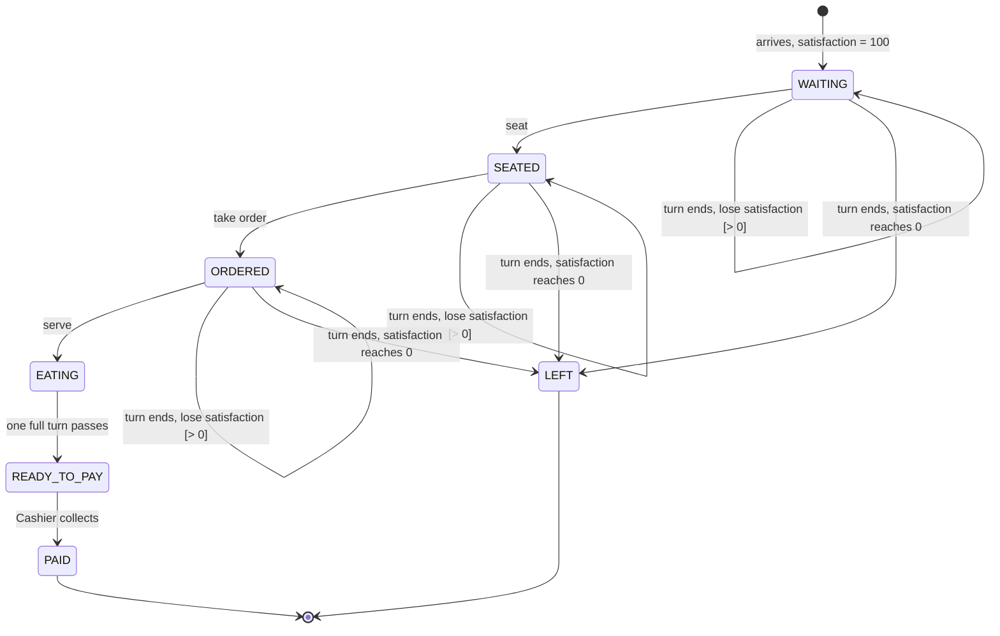

# Design log

One entry per design decision or change: what we chose, what we rejected, and why.
This feeds the report's trade-offs, alternative design and stage-evolution sections.

| Date | Decision | Alternatives considered | Why | Who |
|---|---|---|---|---|
| 2026-10-13 | The turn number is owned by `GameController` (private field, only the controller increments it). Customers never keep their own turn counter. | A `static` turn counter inside `Customer` | A static field is shared by every customer and every game (global mutable state), so tests could interfere with each other. A customer only needs to know that one turn passed (`loseSatisfaction()`), or be given the turn as a parameter. | Robin (A) |
| 2026-10-13 | Only WAITING, SEATED and ORDERED lose satisfaction at turn end. EATING and READY_TO_PAY do not (brief §3.2 step 5). | Stop the loss when the dish becomes READY | A READY dish that is not yet served still leaves the customer waiting. | Robin (A) |
| 2026-10-13 | A call made in the wrong state (e.g. `pay` while SEATED) throws `IllegalStateException`. Player mistakes never reach this: the Waiter/controller checks `getState()` first and shows a reason (brief §3.4). | Ignore the call, or return `false` | An exception exposes our own bugs immediately; invalid *player* choices are a separate, user-facing layer. | Robin (A) |
| 2026-10-13 | When satisfaction reaches 0 the customer only flags itself (`hasLeft()`). The controller cancels the order and frees the table. | Customer frees its own table and cancels its order | The customer should not reach into the Table or the kitchen (keeps dependencies pointing one way). | Robin (A) |
| 2026-10-14 | Customer state is a `CustomerState` enum (WAITING, SEATED, ORDERED, EATING, READY_TO_PAY, PAID, LEFT), and each `Customer` method checks the current state before changing it. | **State pattern**: one class per state (`WaitingState`, `SeatedState`, ...) that handles what a customer can do in that state; or storing the state as a `String` | 7 states with small behaviour differences: one class per state is a lot of extra classes for little gain. An enum is checked by the compiler (a typo fails to compile; a `String` typo would only fail at runtime). **Alternative design for the report.** | Robin (A) |
| 2026-10-14 | `Customer` does not store its table number. `Table` already knows its occupant. | `tableNo` field on `Customer` | Storing it twice can get out of sync, and no class needs to read it from the customer. | Robin (A) |
| 2026-10-15 | `Customer` implements exactly the agreed CONTRACT.md methods: `loseSatisfaction()`, `hasLeft()`, `chooseFood(Menu)`, `getState()`, `recordSatisfactionAtPayment()`, plus `getRecordedSatisfaction()`, which the contract itself lists as a gap. Anything else is an open question for the team (below), not an addition. | Adding methods on our own | The contract is what keeps the three parts independent. | Robin (A) |
| 2026-10-15 | Food choice (D5) lives inside `Customer`: one `static` seeded `Random` and one `static` Pasta count shared by all customers. `chooseFood(menu)` picks from the menu, re-picks a 3rd Pasta, and returns the dish. Caleb creates customers with just `new RegularCustomer(id)`. | A `FoodPicker` object created by the controller and passed to every customer; a new `Random` inside each customer | A `FoodPicker` would make Caleb create and pass an extra object the contract never mentions. A new `Random(seed)` per customer would repeat the same first number, so every customer would order the same dish. **Trade-off:** `static` state is shared by the whole program, which is fine for one game per run; tests need a way to reset it. | Robin (A) |
| 2026-10-15 | `loseSatisfaction()` does nothing outside WAITING, SEATED and ORDERED (as the contract note says), because it is called on every customer at turn end. | Throwing when called on an EATING customer | Being called on everyone each turn is normal, not a bug. | Robin (A) |
| 2026-10-15 | `recordSatisfactionAtPayment()` stores the current satisfaction, as the contract says. | Not storing it (satisfaction cannot change after SERVED, so it equals the current value) | The contract and the brief ("satisfaction recorded when each customer pays") ask for it, and it keeps the average independent of later changes. | Robin (A) |
| 2026-10-15 | **Stage 1 `Customer` is one ordinary (not abstract) class**, with a constant `LOSS_PER_TURN = 8`. No subclasses in Stage 1. | Abstract `Customer` + `RegularCustomer`, with the loss as an overridable method or a constructor parameter (DECISIONS D13) | Stage 1 is designed from the Stage 1 requirements only (professor's guidance): there is one kind of customer and one loss value. When Stage 2 adds VIP and Critic, `Customer` becomes the parent class and the loss moves into the subclasses; that refactor is explained in the README's Stage 1 → 2 section. | Robin (A) |
| 2026-10-15 | **No discount method in Stage 1.** In Stage 1 the bill is the item price. The discount (and the B → A `getDiscountPercent()` call) is added in Stage 2 with `VIPCustomer`. | `getDiscountPercent()` returning 0 from Stage 1 (agreed plan, CONTRACT.md B → A) | Stage 1 is designed from the Stage 1 requirements only (professor's guidance), so a discount that is always 0 does not belong there. Adding it in Stage 2 is a documented Stage 1 → 2 change. *Ian informed.* | Robin (A) |

## Open questions for the team (Customer)

The contract only lets other classes **read** a customer's state (`getState()`). It has no way to **change** it, so the Waiter cannot seat a customer and the Cashier cannot mark one paid. This has to be agreed before Stage 1 code is written.

| # | Question | Options | Robin's suggestion |
|---|---|---|---|
| Q1 | How do the Waiter, Cashier and controller change a customer's state (seated, order taken, served, finished eating, paid)? | (a) `setState(CustomerState)`: simplest, but any class can put a customer in any state; (b) one method per event, e.g. `seat()`, `serve(turn)`: the customer refuses illegal changes | (b), because the customer then enforces the state machine (encapsulation) |
| Q2 | Who remembers when a customer was served, for "one full turn of eating" (brief §3.2 step 4)? | The customer (given the turn when served), or the controller | Depends on Q1 |
| Q3 | Does Caleb's display need `getId()` and `getSatisfaction()`? (Brief §3.1 shows each customer's satisfaction.) | Add them, or Caleb reads them another way | Add them: plain getters, no rules |
| Q4 | Cashier "oldest first" (D2): does the Cashier need anything from the customer? | A first-in-first-out queue in the Cashier needs nothing from the customer | Queue in the Cashier |

## Customer class diagram (v1, Stage 1)

Drawn by Robin on 2026-10-15: [uml/customer-class-v1.png](uml/customer-class-v1.png). Stage 1 only: one ordinary `Customer` class, the `CustomerState` enum, and Ian's `Menu`/`MenuItem` (only used by `chooseFood`).

Pending team answers (see "Open questions" above): whether `tableNo`/`getTable()` and `chosenFood`/`getChosenItem()` are needed, how the eating rule is timed (`finishEating()`), and whether the Cashier calls `pay()` or `recordSatisfactionAtPayment()`.

## Customer state machine (draft v1, Stage 1)

Hand-drawn by Robin on 2026-10-13: [uml/customer-state-v1.png](uml/customer-state-v1.png). The first sketch wrongly had a PAID → LEFT arrow; it was removed (LEFT means "left unhappy without paying" and is counted as an unhappy departure in brief §3.5). The text version below is the same diagram.

Open points: who triggers EATING → READY_TO_PAY (the turn loop, step 4), and whether the customer counts the eating turn itself or is told the turn (see Step 3).
